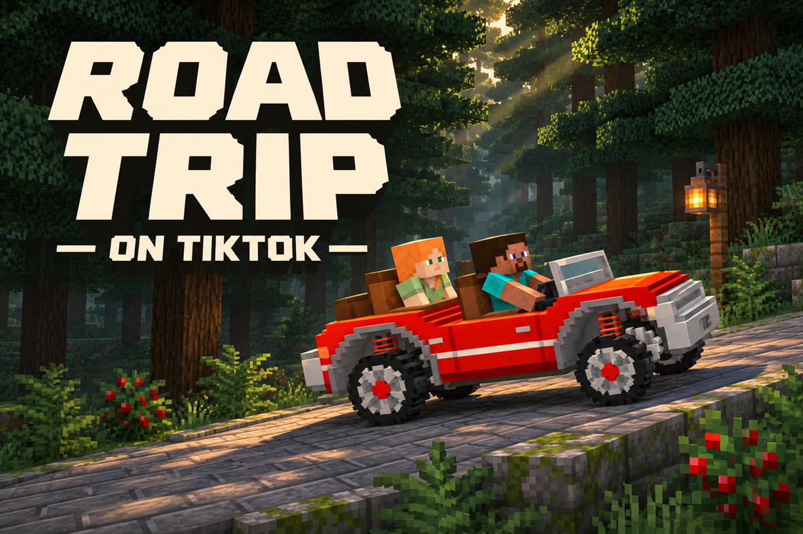

# Road Trip on TikTok



[Логотип PNG](branding/logo.png)

**Minecraft 26.3 · Fabric · Beta 1.0.0-beta.1**

Автономная игра для TikTok LIVE: Стив и Алекс едут на кабриолете к цели **999 999 м**, а зрители помогают или мешают. Машиной управляет мод.

[Скачать бета-релиз](https://github.com/holodse-web/road-trip-on-tiktok/releases) · [Сообщить об ошибке](https://github.com/holodse-web/road-trip-on-tiktok/issues)

## Что делают зрители

| Событие | Эффект по умолчанию |
| --- | --- |
| 500 лайков | +500 м и ускорение |
| Подарок | Метры вперёд или назад, нитро, удары и другие эффекты |
| TikTok Universe / Lion | +999 999 м / −999 999 м |
| Имя моба в чате | Вызывает помощника или препятствие; поддерживаются русский и английский |
| Подписка | Меняет цвет машины |

Подарки, очереди, мобы, камера, погода и оформление настраиваются в браузерном пульте. События можно проверить кнопками без эфира.

## Установка

Нужны **Minecraft 26.3**, **Fabric Loader 0.19.5+**, **Fabric API для 26.3** и **Java 25**. Для встроенного моста дополнительно нужны **Node.js 22+ и npm**.

1. Установите Fabric и скачайте `rttt-1.0.0-beta.1.jar` из [релизов](https://github.com/holodse-web/road-trip-on-tiktok/releases).
2. Положите JAR мода и Fabric API в `.minecraft/mods`. Удалите предыдущую версию мода, если она есть.
3. Запустите Minecraft и создайте одиночный мир со словом **RTTT** или **Road Trip** в названии — игра включится автоматически. В другом мире нажмите **F6**.
4. Откройте пульт клавишей **F7** или по адресу [127.0.0.1:8765](http://127.0.0.1:8765/).

## Подключение TikTok LIVE

Выберите один способ:

- **TikFinity:** подключите свой эфир в TikFinity. Мод подключается к `ws://127.0.0.1:21213/` автоматически.
- **Встроенный мост:** во вкладке **TikTok** введите ник и нажмите **Запустить мост**. При первом запуске npm установит зависимости; состояние и журнал доступны там же. При закрытии Minecraft мост останавливается.

Не запускайте оба способа одновременно: им нужен один порт **21213**. Для ручного запуска моста есть `bridge/start-bridge.bat`.

## Управление и трансляция

| Клавиша | Действие |
| --- | --- |
| **F6** | Запустить / остановить игру |
| **F7** | Открыть пульт |
| **F8** | Вписать вертикальное окно 9:16 в монитор |

Команды: `/rttt start`, `/rttt stop`, `/rttt restart`, `/rttt panel`.

Для OBS / Live Studio выберите вертикальный холст **1080×1920**. Режим **Full HD · захват игры** в пульте создаёт кадр 1080×1920; используйте источник **Захват игры** и проверьте полный кадр в предпросмотре. Пульт можно добавить в OBS как док браузера.

## Сборка из исходников

Windows: сначала запустите Minecraft 26.3 с Fabric хотя бы один раз и установите Fabric API в `.minecraft/mods`. Сборка берёт игровые библиотеки из этой папки; Gradle не требуется.

```bat
build.bat --no-install
```

Результат: `build/rttt-1.0.0-beta.1.jar`. Без `--no-install` сборка также копирует мод в `.minecraft/mods`. Для другой папки игры: `build.bat --no-install "D:\Minecraft"`. Нужен JDK 25; скрипт сначала ищет Java в стандартной папке лаунчера, затем в `PATH`.

## Права и материалы

- Код мода: **All Rights Reserved**. Сторонние компоненты распространяются по своим лицензиям.
- Inter: **SIL OFL 1.1**, текст лицензии в [LICENSES/Inter-OFL.txt](LICENSES/Inter-OFL.txt).
- Звуки двигателя, тормозов, удара и клаксона: **CC0**, [pmndrs/racing-game](https://github.com/pmndrs/racing-game). Остальные синтезированы для мода или используются из Minecraft.
- Иконки подарков принадлежат TikTok: не включены в репозиторий и релизный JAR, загружаются модом отдельно.
- Мост устанавливает `tiktok-live-connector` (**AGPL-3.0-only**) через npm отдельно; библиотека не включена в JAR.
